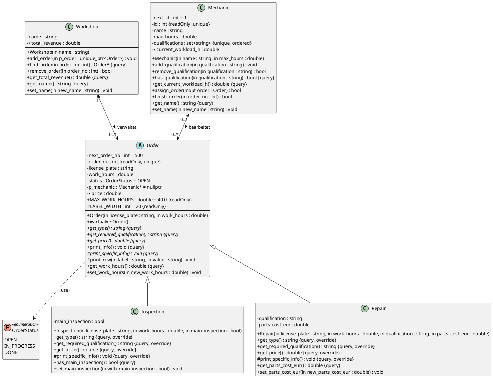

# Musterlösung – Probeklausur 02 „Kfz-Werkstatt“

> Erst öffnen, wenn du fertig bist! Inoffizielle Lösung, nicht vom Prof.
>
> Der Code in diesem Ordner wurde mit `g++ -std=c++17 -Wall -Wextra -pedantic -Werror`
> ohne Warnungen kompiliert. Die Ausgabe von `print_info()` stimmt **zeichengenau** mit dem
> Aufgabenblatt überein. Das wird automatisch getestet (siehe [Abschnitt 9](#9-tests)).

**Inhalt**

0. [Vorgehen in der Klausur (Zeitplan)](#0-vorgehen-in-der-klausur-zeitplan)
1. [Textanalyse: vom Aufgabentext zu den Klassen](#1-textanalyse-vom-aufgabentext-zu-den-klassen)
2. [a) UML-Klassendiagramm](#2-a-uml-klassendiagramm)
3. [b) Implementierung Datei für Datei](#3-b-implementierung-datei-für-datei)
4. [Preisberechnung durchgerechnet](#4-preisberechnung-durchgerechnet)
5. [c) `main` und erwartete Ausgabe](#5-c-main-und-erwartete-ausgabe)
6. [e) Antworten auf die Fragen](#6-e-antworten-auf-die-fragen)
7. [Vollständigkeits-Checkliste (Anforderung → Code)](#7-vollständigkeits-checkliste-anforderung--code)
8. [Typische Fehler](#8-typische-fehler)
9. [Tests](#9-tests)
10. [Bewertungsschema](#10-bewertungsschema)

---

## 0. Vorgehen in der Klausur (Zeitplan)

| Zeit | Schritt |
|---|---|
| 10 min | Text **zweimal** lesen. Substantive markieren (→ Klassen/Attribute), Verben (→ Methoden), Zahlen (→ Konstanten), Sätze mit „nur wenn“, „darf nicht“ (→ Prüfungen/Exceptions), „wird gelöscht“ (→ Komposition). |
| 25 min | UML zeichnen (a). Lieber vollständig als schön. |
| 60 min | Code (b). Reihenfolge: `order.hpp` → `order.cpp` → `mechanic.*` → `workshop.*`. **Nach jeder Datei kompilieren.** |
| 15 min | `main` (c). Jeden geforderten Fall einmal abhaken. |
| 10 min | Fragen (e) als Kommentar in `main.cpp`, Rest: Ausgabe mit dem Aufgabenblatt vergleichen. |

Wichtig: Kompilierfähigkeit (d) ist Voraussetzung. Ein Programm, das nicht kompiliert, kann sehr
viele Punkte kosten. Deshalb lieber eine Funktion weglassen als einen Compilerfehler abgeben.

---

## 1. Textanalyse: vom Aufgabentext zu den Klassen

### 1.1 Klassen finden

| Textstelle | Erkenntnis |
|---|---|
| „unterschiedliche Auftragsarten: Inspektionen, Reparaturen“ + „Alle Aufträge besitzen gemeinsame Eigenschaften“ | Basisklasse `Order` mit den Unterklassen `Inspection` und `Repair` (Vererbung, „ist ein“). |
| „Preis … wird immer berechnet“, aber die Regel ist **pro Art verschieden** | `get_price()` ist in `Order` **rein virtuell** → `Order` wird automatisch **abstrakt**. Das erfüllt „mindestens eine abstrakte Klasse“. |
| „Auch die Mechaniker werden verwaltet“ | Klasse `Mechanic` |
| „Alle Aufträge werden in einer Werkstatt verwaltet“ | Klasse `Workshop` |
| „Auftragsstatus … typsicher“ | `enum class OrderStatus { OPEN, IN_PROGRESS, DONE }` |

### 1.2 Attribute und ihre Besonderheiten

| Text | Attribut | Besonderheit | Umsetzung im Code |
|---|---|---|---|
| „eindeutige Auftragsnummer, automatisch, beginnend bei 500“ | `order_no` | eindeutig, nur lesbar | `const int order_no` + `static int next_order_no = 500` |
| „Kennzeichen (darf nicht leer sein)“ | `license_plate` | Validierung | Exception bei `""` |
| „geschätzte Arbeitszeit in Stunden“, „> 0 und höchstens 40“ | `work_hours` | Validierung | `MAX_WORK_HOURS = 40.0`, Exception |
| „Auftragsstatus“ | `status` | typsicher, Startwert OPEN | `OrderStatus status` |
| „zuständiger Mechaniker“ | `p_mechanic` | Assoziation, Startwert „keiner“ | `Mechanic* p_mechanic = nullptr` |
| „benötigte Qualifikation“ | – | bei Inspektion fest, bei Reparatur gespeichert | rein virtuelle Methode `get_required_qualification()` |
| „Preis … nicht gespeichert“ | `/price` | **abgeleitet** | nur `get_price()`, **kein** Attribut |
| Inspektion: „ob eine HU mit durchgeführt wird“ | `main_inspection` | – | `bool` |
| Reparatur: „benötigte Qualifikation“, „Materialkosten“ | `qualification`, `parts_cost_eur` | Kosten ≥ 0 | `std::string`, `double` + Exception |
| Mechaniker: „ID … nur einmalig gesetzt … eindeutig“ | `id` | eindeutig, readOnly | `const int id` + `static int next_id` |
| „maximale Arbeitszeit (muss > 0 sein)“ | `max_hours` | Validierung | Exception |
| „Qualifikationen … suchen … keine doppelten Einträge“ | `qualifications` | Container | `std::set<std::string>` |
| „aktuelle Auslastung wird … berechnet“ | `/current_workload_h` | **abgeleitet** | nur `get_current_workload_h()` |
| Werkstatt: „Umsatz … Summe der Preise aller abgeschlossenen Aufträge“ | `/total_revenue` | **abgeleitet** | nur `get_total_revenue()` |

**Der Knackpunkt „benötigte Qualifikation“:** Sie steht bei den *gemeinsamen* Eigenschaften, aber
bei der Inspektion ist sie immer `"Maintenance"` und bei der Reparatur ein gespeicherter Wert.
Würde man in `Order` ein Attribut `qualification` anlegen, müsste jede Inspektion denselben String
noch einmal speichern, und jemand könnte ihn per Setter auf `"Body"` ändern. Sauberer ist: `Order`
verspricht nur, dass es die Qualifikation **liefern** kann (rein virtuelle Methode), jede Unterklasse
entscheidet selbst, **wie**. Beides wird akzeptiert, die polymorphe Variante zeigt aber, dass man
Polymorphie verstanden hat.

### 1.3 Methoden aus den Verben

| Text | Methode |
|---|---|
| „mit `printInfo()` alle Attribute … ausgeben“ | `Order::print_info() const` |
| „Qualifikationen hinzufügen, entfernen und abfragen“ | `add_qualification`, `remove_qualification`, `has_qualification` |
| „Einem Mechaniker können … zugewiesen werden, aber nur, wenn …“ | `bool assign_order(Order& order)` |
| „schließt **einen** seiner Aufträge über die Auftragsnummer ab … über den Rückgabewert gemeldet“ | `bool finish_order(int order_no)` |
| „über seine Auftragsnummer gesucht“ | `Order* find_order(int order_no) const` |
| „entfernt … nur, wenn abgeschlossen, andernfalls Exception“ | `bool remove_order(int order_no)` |
| „Umsatz berechnen“ | `double get_total_revenue() const` |

### 1.4 Beziehungen aus den Sätzen

| Satz | Beziehung |
|---|---|
| „Wird eine Werkstatt aufgelöst, werden auch alle ihre Aufträge gelöscht“ | **Komposition** Workshop ◆→ Order. Die Lebensdauer der Aufträge hängt an der Werkstatt. |
| „Einem Mechaniker können mehrere Aufträge zugewiesen werden“ + „zuständiger Mechaniker“ beim Auftrag | **bidirektionale Assoziation** Mechanic ↔ Order. Der Mechaniker besitzt die Aufträge nicht. |
| „Inspektion / Reparatur sind Aufträge“ | **Vererbung** |

---

## 2. a) UML-Klassendiagramm

PlantUML-Syntax. Rendern z.B. mit der VS-Code-Extension „PlantUML“ oder auf plantuml.com.



### 2.1 Was jedes Notationselement bedeutet

| Element | Bedeutung | Wo im Diagramm |
|---|---|---|
| `+` / `-` / `#` | public / private / protected | Attribute sind alle `-` (Datenkapselung). `print_specific_info` und `print_row` sind `#`, weil nur Unterklassen sie brauchen. |
| `{static}` (oder unterstrichen) | gehört zur Klasse, nicht zum Objekt | `next_order_no`, `next_id`, `MAX_WORK_HOURS`, `LABEL_WIDTH`, `print_row` |
| `{readOnly}` | nach der Initialisierung nicht mehr änderbar (`const`) | `order_no`, `id`, Konstanten |
| `{unique}` | Wert ist über alle Objekte eindeutig | `order_no`, `id`; bei `set<string>`: keine Duplikate |
| `/` vor dem Namen | **abgeleitetes Attribut**: wird berechnet, nicht gespeichert | `/price`, `/current_workload_h`, `/total_revenue` |
| *kursiv* bzw. `{abstract}` | abstrakte Klasse / rein virtuelle Methode | `Order`, `get_type`, `get_price`, `get_required_qualification`, `print_specific_info` |
| `{query}` | ändert das Objekt nicht (`const`-Methode) | alle Getter, `print_info`, `get_price` … |
| `{override}` | überschreibt eine virtuelle Methode der Basisklasse | in `Inspection` und `Repair` |
| `in` / `inout` | Parameterrichtung. `in`: wird nur gelesen. `inout`: wird gelesen **und verändert**. | `assign_order(inout order)`, weil der Auftrag Status und Mechaniker bekommt |
| `= 500`, `= OPEN`, `= nullptr` | Startwert | aus dem Text: „beginnend bei 500“, „neu angelegte Aufträge sind offen und haben keinen Mechaniker“ |

### 2.2 Beziehungen im Detail

| Beziehung | Art | Navigierbarkeit | Multiplizität | Begründung aus dem Text |
|---|---|---|---|---|
| Workshop – Order | **Komposition** (gefüllte Raute an Workshop) | Workshop → Order | 1 zu 0..* | „Wird eine Werkstatt aufgelöst, werden auch alle ihre Aufträge gelöscht.“ Ein Auftrag gehört zu genau **einer** Werkstatt. |
| Mechanic – Order | **Assoziation** | bidirektional | 0..1 zu 0..* | Ein Mechaniker hat 0 bis viele Aufträge. Ein Auftrag hat 0 (offen) oder 1 Mechaniker. Der Auftrag muss seinen Mechaniker kennen (Ausgabe „Mechanic“), der Mechaniker seine Aufträge (Auslastung, Abschließen). |
| Inspection/Repair – Order | Vererbung | – | – | „ist ein“ Auftrag |
| Order – OrderStatus | Abhängigkeit `<<use>>` | – | – | optional, viele zeichnen sie nicht |

**Leserichtung der Multiplizitäten:** `Mechanic "0..1" <--> "0..*" Order` liest man so: Ein
Mechaniker bearbeitet **0..*** Aufträge (die Zahl steht am *anderen* Ende), und ein Auftrag wird von
**0..1** Mechanikern bearbeitet.

**Feinheit:** Nach `finish_order` steht der Auftrag nicht mehr in der Liste des Mechanikers, merkt
sich aber weiterhin „wer hat mich bearbeitet“. Die Navigation ist dann nur noch Order → Mechanic.
Das ist mit der Multiplizität 0..1/0..* abgedeckt.

**Warum steht `assigned_orders` nicht als Attribut im Diagramm?** Das Assoziationsende „0..*
Order“ an `Mechanic` *ist* diese Liste. Wer sie zusätzlich als Attribut einträgt, hat sie doppelt.
Viele Profs akzeptieren beides, aber nicht widersprüchlich. Dasselbe gilt für `orders` in `Workshop`.
`p_mechanic` steht hier trotzdem drin, weil es der Startwert `= nullptr` aus dem Text sichtbar macht.
Wer konsequent sein will, lässt es weg und schreibt den Startwert in eine Notiz.

---

## 3. b) Implementierung Datei für Datei

### 3.1 [order.hpp](order.hpp) / [order.cpp](order.cpp)

**Forward Declaration.** `order.hpp` schreibt nur `class Mechanic;` statt `#include
"mechanic.hpp"`. Grund: `Order` kennt `Mechanic` und `Mechanic` kennt `Order`. Würden sich die
Header gegenseitig inkludieren, verhindert der Include-Guard das zweite Einbinden und eine der
Klassen ist unbekannt → Compilerfehler. Für einen **Zeiger** (`Mechanic*`) reicht dem Compiler,
dass der Name eine Klasse ist. Erst in `order.cpp`, wo `p_mechanic->get_name()` aufgerufen wird,
braucht man die vollständige Klasse, also dort `#include "mechanic.hpp"`.

**`enum class` statt `enum`/`int`/`string`.** `enum class` ist „typsicher“: `OrderStatus s = 1;`
und `int x = OrderStatus::OPEN;` kompilieren nicht, und die Namen sind im Scope `OrderStatus::`
gekapselt. Bei einem `string` könnte man sich vertippen (`"in progres"`) und niemand merkt es.

**Eindeutige Nummer.** Das Muster für automatisch vergebene IDs:

```cpp
// order.hpp
static int next_order_no;   // ein Zähler für ALLE Aufträge
const int order_no;         // jeder Auftrag hat seine eigene, unveränderliche Nummer

// order.cpp
int Order::next_order_no = 500;   // static Member MUSS in genau einer .cpp definiert werden

Order::Order(...) : order_no(next_order_no++), ...   // erst Wert nehmen, dann erhöhen
```

- `const` + kein Setter = „nur einmalig gesetzt“. Ein `const`-Member **muss** in der
  Initialisierungsliste gesetzt werden, eine Zuweisung im Konstruktor-Rumpf wäre ein Compilerfehler.
- `next_order_no++` (Post-Inkrement) liefert 500 und erhöht danach auf 501.
- Ohne die Zeile `int Order::next_order_no = 500;` in der .cpp gibt es einen **Linkerfehler**
  („undefined reference to Order::next_order_no“). Das ist einer der häufigsten Klausurfehler.
- `MAX_WORK_HOURS` ist `static constexpr double` und darf deshalb direkt im Header initialisiert
  werden (bei `double` geht das mit `static const` **nicht**, nur mit `constexpr`).

**Nebeneffekt, den man kennen sollte:** Wirft der Konstruktor (z.B. bei 0 h), wurde
`next_order_no++` schon ausgeführt. In `main` wird deshalb die Nummer 504 „verbraucht“, obwohl der
Auftrag nie existiert. Das ist erlaubt, denn verlangt ist nur Eindeutigkeit, keine Lückenlosigkeit
(Rechnungsnummern in echten Systemen haben auch Lücken). Deshalb wird der ungültige Auftrag in
`main` erst **nach** den gültigen angelegt, damit die Nummern 500–503 zum Aufgabenblatt passen.

**Kopieren verbieten.** `Order(const Order&) = delete;` und `Order& operator=(const Order&) =
delete;`. Begründung siehe [Frage e1](#e1-kopierkonstruktor-und-zuweisungsoperator-verbieten).

**Virtueller Destruktor.** `virtual ~Order() = default;` ist Pflicht, weil die Werkstatt die
Aufträge über `std::unique_ptr<Order>` (also über einen Basisklassenzeiger) löscht. Ohne `virtual`
würde nur `~Order()` laufen, der `std::string qualification` einer `Repair` würde nie freigegeben
(formal: undefiniertes Verhalten).

**Validierung in Konstruktor *und* Setter.** Die Prüfungen stehen in kleinen Hilfsfunktionen in
einem anonymen Namespace (nur in dieser .cpp sichtbar):

```cpp
double validated_work_hours(double work_hours)
{
    if (work_hours <= 0.0 || work_hours > Order::MAX_WORK_HOURS)   // > 0 und höchstens 40
    {
        throw std::invalid_argument(...);
    }
    return work_hours;
}
```

Sie geben den Wert zurück, deshalb kann man sie direkt in der Initialisierungsliste benutzen:
`work_hours(validated_work_hours(work_hours))`. Der Setter benutzt dieselbe Funktion:
`work_hours = validated_work_hours(new_work_hours);`. Wirft sie, wird **nichts** zugewiesen, der
alte Wert bleibt erhalten. Wer nur im Konstruktor prüft, lässt eine Hintertür offen: `set_work_hours(-5)`.

Grenzen genau lesen: „größer als 0“ → `<= 0.0` ist ungültig. „höchstens 40“ → `> 40` ist ungültig,
**40 selbst ist erlaubt**. „nicht negativ“ → `< 0.0` ist ungültig, 0 € Material ist erlaubt.

**`std::invalid_argument`** ist die passende Standard-Exception für „ungültiger Parameterwert“
(Header `<stdexcept>`).

**Template Method Pattern bei der Ausgabe.** `print_info()` ist **nicht** virtuell und gibt den
gemeinsamen Teil aus. In der Mitte ruft es die rein virtuelle `print_specific_info()` auf, die jede
Unterklasse mit ihren eigenen Zeilen füllt:

```
print_info()  (Order, nicht virtuell)
 ├─ Type, Order No, License Plate, Work Hours, Qualification   ← gemeinsam
 ├─ print_specific_info()   ← virtuell: "Main Inspection" ODER "Parts Cost"
 └─ Price, Status, Mechanic, -----                             ← gemeinsam
```

Vorteil: Der gemeinsame Teil steht nur **einmal** im Code. Eine neue Auftragsart (z.B. `TireChange`)
muss nur ihre eigene Zeile liefern („wiederverwendbar und erweiterbar“). `get_type()`,
`get_required_qualification()` und `get_price()` werden in `print_info()` ebenfalls virtuell
aufgerufen.

**Tabellenformat.** `std::left << std::setw(20) << label` füllt das Label linksbündig auf 20 Zeichen
auf, dadurch steht die zweite Spalte senkrecht untereinander. `LABEL_WIDTH = 20` ist eine Konstante
statt einer magischen Zahl. Geldbeträge: `std::fixed << std::setprecision(2)` → `935.00`. Die
Arbeitszeit wird **ohne** `fixed` ausgegeben, damit `1.5 h` und `10 h` wie im Beispiel erscheinen
(Standardformat lässt unnötige Nachkommastellen weg). Die Beträge werden in einem eigenen
`std::ostringstream` formatiert, so bleibt `std::cout` unverändert.

**Konstanten statt magischer Zahlen.** `HOURLY_RATE_EUR`, `INSPECTION_BASE_FEE_EUR`,
`MAIN_INSPECTION_FEE_EUR`, `LONG_REPAIR_LIMIT_H`, `LONG_REPAIR_LABOUR_FACTOR`. Wenn der Stundensatz
steigt, ändert man genau eine Zeile.

### 3.2 [mechanic.hpp](mechanic.hpp) / [mechanic.cpp](mechanic.cpp)

**`std::set<std::string>` für die Qualifikationen.** Anforderungen: „suchen“ und „keine doppelten
Einträge“. `std::set` erfüllt beides automatisch: `insert` ignoriert Duplikate, `find` sucht in
O(log n). Mit `std::vector` müsste man vor jedem Einfügen selbst nach Duplikaten suchen.
`remove_qualification` gibt `erase(...) > 0` zurück, also `true`, wenn wirklich etwas entfernt wurde.

**Abgeleitete Auslastung.** `get_current_workload_h()` summiert bei jedem Aufruf die Stunden der
zugewiesenen Aufträge. Es gibt **kein** Attribut `current_workload`, das man beim Zuweisen und
Abschließen mitpflegen müsste. So kann es auch nie falsch sein.

**`assign_order(Order& order)` – die drei Bedingungen:**

```cpp
if (order.get_status() != OrderStatus::OPEN)                     return false;  // 1. offen?
if (!has_qualification(order.get_required_qualification()))      return false;  // 2. Qualifikation?
if (get_current_workload_h() + order.get_work_hours() > max_hours) return false; // 3. Kapazität?

assigned_orders.push_back(&order);       // Seite Mechanic → Order
order.set_mechanic(this);                // Seite Order → Mechanic
order.set_status(OrderStatus::IN_PROGRESS);
return true;
```

- Alle Prüfungen kommen **vor** der ersten Änderung. Bei einer Ablehnung bleibt alles, wie es war.
- Bedingung 1 verhindert auch, dass ein Auftrag zwei Mechanikern (oder demselben zweimal)
  zugewiesen wird.
- Bedingung 3: „nicht überschreitet“ → `>` ist verboten, **genau gleich ist erlaubt**
  (10 h + 1 h bei max. 11 h geht).
- `get_required_qualification()` wird virtuell aufgerufen. `Mechanic` muss nicht wissen, ob es
  eine Inspektion oder Reparatur ist. Das ist Polymorphie, kein `if (typ == ...)` nötig.
- Bei einer bidirektionalen Assoziation müssen **beide Seiten** gesetzt werden. Vergisst man
  `set_mechanic(this)`, steht in der Ausgabe „Mechanic None“, obwohl der Auftrag zugewiesen ist.
- Parameter ist eine **Referenz** (`Order&`), kein Wert: Bei Übergabe per Wert würde eine Kopie
  verändert (und die ist ohnehin verboten). Referenz statt Zeiger, weil ein Auftrag immer übergeben
  werden muss (`nullptr` ist kein sinnvoller Wert).

**`finish_order(int order_no)`:**

```cpp
auto it = std::find_if(assigned_orders.begin(), assigned_orders.end(),
                       [order_no](const Order* p_order) { return p_order->get_order_no() == order_no; });
if (it == assigned_orders.end()) return false;   // nicht mein Auftrag → Rückgabewert meldet es
(*it)->set_status(OrderStatus::DONE);            // Mechaniker-Zeiger im Auftrag bleibt ("bearbeitet von")
assigned_orders.erase(it);                       // nur die Verknüpfung entfernen, NICHT delete!
return true;
```

`std::find_if` mit einer Lambda-Funktion sucht das erste Element, für das die Bedingung gilt. Eine
normale `for`-Schleife mit Index und `erase(begin() + i)` ist genauso richtig. **Wichtig:** Nach
`erase` ist der Iterator ungültig, deshalb wird erst der Status gesetzt und dann gelöscht.
`delete` wäre hier ein schwerer Fehler: Der Auftrag gehört der Werkstatt (Komposition), der
Mechaniker hat nur einen „ausgeliehenen“ Zeiger.

### 3.3 [workshop.hpp](workshop.hpp) / [workshop.cpp](workshop.cpp)

**Komposition mit `std::vector<std::unique_ptr<Order>>`.**
- Polymorphe Objekte (`Inspection`, `Repair`) kann man nicht direkt in einen `vector<Order>`
  legen (abstrakt + Slicing). Man braucht Zeiger.
- `unique_ptr` drückt „ich bin der einzige Besitzer“ aus. Wird die Werkstatt zerstört, zerstört
  der Vector seine `unique_ptr`, die zerstören die Aufträge. Kein eigener Destruktor nötig (Rule of Zero).
- Die Objekte liegen auf dem Heap und bewegen sich nicht, wenn der Vector wächst. Deshalb bleiben
  die rohen Zeiger der Mechaniker gültig.
- `add_order(std::unique_ptr<Order> p_order)` nimmt den Zeiger **per Wert**: Der Aufrufer muss
  `std::move` bzw. `std::make_unique` verwenden und gibt damit sichtbar den Besitz ab.

**`find_order`** liefert `Order*` (nicht-besitzend) oder `nullptr`. Die Methode ist `const`, weil
sie die Werkstatt nicht verändert.

**`remove_order`** prüft in dieser Reihenfolge:
1. Nummer nicht gefunden → `false` (kein Fehler im Programmablauf, nur „gibt’s nicht“).
2. Status nicht `DONE` → `throw std::logic_error(...)`. Das ist eine Verletzung einer Vorbedingung
   (Achtung: `std::invalid_argument` erbt von `std::logic_error`. Ein `catch (const
   std::logic_error&)` fängt also beide. Deshalb fängt `main` beim Entfernen gezielt `logic_error`.)
3. Sonst `orders.erase(it)`. Der `unique_ptr` löscht den Auftrag.

**`get_total_revenue()`** summiert `get_price()` aller Aufträge mit Status `DONE`. Der Aufruf ist
polymorph: Für jede `Inspection` und jede `Repair` wird die richtige Preisformel verwendet, ohne dass
die Werkstatt die Unterklassen kennt.

### 3.4 Was bewusst **nicht** umgesetzt ist (Grenzfälle außerhalb der Aufgabe)

- `set_work_hours` bei einem bereits zugewiesenen Auftrag könnte die Auslastung des Mechanikers
  über `max_hours` treiben. Die Aufgabe verlangt dazu nichts. In einer echten Software würde man
  das prüfen oder den Setter nur für offene Aufträge erlauben.
- `remove_qualification` wirkt nur auf künftige Zuweisungen, schon zugewiesene Aufträge bleiben.
- Wird ein `Mechanic`-Objekt zerstört, zeigt `p_mechanic` eines abgeschlossenen Auftrags ins
  Leere. In `main` passiert das erst am Programmende (nach der letzten Ausgabe), ist also
  unkritisch. Professionell löst man das z.B. mit `std::weak_ptr` oder indem man nur die ID speichert.

---

## 4. Preisberechnung durchgerechnet

Stundensatz 65,00 €.

| Nr. | Auftrag | Rechnung | Preis |
|---|---|---|---|
| 500 | Inspektion, 1,5 h, mit HU | 49,00 + 1,5 · 65,00 + 119,00 = 49,00 + 97,50 + 119,00 | **265,50 €** |
| 501 | Reparatur, 10 h, Engine, Material 350,00 | Lohn 10 · 65 = 650,00; 10 h **> 8 h** → 650,00 · 0,9 = 585,00; + 350,00 | **935,00 €** |
| 502 | Inspektion, 1 h, ohne HU | 49,00 + 65,00 | **114,00 €** |
| 503 | Reparatur, 3 h, Electrics, Material 120,00 | 3 · 65 = 195,00 (kein Rabatt) + 120,00 | **315,00 €** |
| – | Reparatur, genau 8 h, Material 0 | 8 · 65 = 520,00, **kein** Rabatt, da nicht „mehr als 8“ | 520,00 € |

**Typischer Fehler:** Rabatt auf den Gesamtpreis: (650 + 350) · 0,9 = 900,00 € statt 935,00 €.
Der Text sagt ausdrücklich „auf den Arbeitslohn (nicht auf das Material)“.

---

## 5. c) `main` und erwartete Ausgabe

Datei: [main.cpp](main.cpp). Die Mechaniker sind so gewählt, dass **jede** Ablehnungsbedingung
einzeln auftritt:

| Mechaniker | max. Stunden | Qualifikationen |
|---|---|---|
| Lena Vogt | 11 h | Maintenance, Engine |
| Max Huber | 8 h | Maintenance, Electrics |

| Schritt | Ergebnis | Grund |
|---|---|---|
| Ungültige Reparatur mit 0 h | Exception wird gefangen | Arbeitszeit muss > 0 sein |
| Lena ← 501 (Engine, 10 h) | `true` | offen, qualifiziert, 0 + 10 ≤ 11 |
| Lena ← 500 (1,5 h) | `false` | **Bedingung 3**: 10 + 1,5 = 11,5 > 11 |
| Lena ← 503 (Electrics) | `false` | **Bedingung 2**: Lena hat kein „Electrics“ |
| Max ← 503 (3 h) | `true` | |
| Max ← 501 | `false` | **Bedingung 1**: 501 ist schon „In Progress“ |
| Max ← 502 (1 h) | `true` | 3 + 1 = 4 ≤ 8 |
| Ausgabe aller Aufträge über `const Order* p_base` | 500 Open/None, 501–503 In Progress | |
| Umsatz | 0,00 € | noch nichts abgeschlossen |
| Max schließt 503 ab | `true` | |
| Max schließt 501 ab | `false` | gehört Lena |
| Lena schließt 501 ab | `true`, Auslastung danach 0 h | |
| Umsatz | 1250,00 € | 935,00 + 315,00 |
| Entferne 502 | `logic_error` wird gefangen | 502 ist noch in Bearbeitung |
| Entferne 503 | `true` | abgeschlossen |
| Entferne 999 | `false` | unbekannt |
| Umsatz | 935,00 € | 503 ist archiviert |
| Ausgabe aller Aufträge | 500 Open, 501 Done (Lena Vogt), 502 In Progress | |

Die vollständige Ausgabe steht in [tests/expected_main_output.txt](tests/expected_main_output.txt)
und wird vom Testskript automatisch verglichen.

**Warum `std::vector<std::unique_ptr<Mechanic>>` und nicht `std::vector<Mechanic>`?** Die Aufträge
speichern `Mechanic*`. Würde der Vector beim `push_back` wachsen, verschiebt er seine Elemente an
eine neue Adresse, und alle Zeiger wären ungültig. Mit `unique_ptr` liegen die Mechaniker fest auf
dem Heap. Außerdem kompiliert `std::vector<Mechanic>` hier gar nicht, auch nicht mit `reserve()` und
`emplace_back`: Der Vector verlangt, dass er seine Elemente beim Wachsen kopieren oder verschieben
kann. Der Kopierkonstruktor ist aber gelöscht, und dadurch erzeugt der Compiler auch keinen
Move-Konstruktor. (Ausprobiert: g++ meldet „use of deleted function Mechanic(const Mechanic&)“.)

**„über einen Basisklassenzeiger“:** In der Schleife wird ausdrücklich `const Order* p_base =
p_order.get();` geschrieben und darüber `print_info()` aufgerufen. So sieht der Korrektor sofort,
dass die Anforderung erfüllt ist.

---

## 6. e) Antworten auf die Fragen

Die Antworten stehen auch als Kommentar oben in [main.cpp](main.cpp), so wie die Aufgabe es verlangt.

### e1) Kopierkonstruktor und Zuweisungsoperator verbieten

Der vom Compiler erzeugte Kopierkonstruktor macht eine **flache Kopie** aller Attribute:
- Die Kopie hätte **dieselbe Auftragsnummer** → `{unique}` verletzt, `find_order` würde nur einen
  der beiden finden.
- `p_mechanic` würde mitkopiert: Die Kopie „glaubt“, sie werde von Lena bearbeitet, aber Lena kennt
  nur das Original → die bidirektionale Assoziation ist **inkonsistent**.
- Bei einer Basisklasse kommt **Slicing** dazu: Kopiert man eine `Repair` über eine `Order&`, geht
  der `Repair`-Teil (Qualifikation, Materialkosten) verloren.

Der Zuweisungsoperator wird übrigens wegen des `const int order_no` vom Compiler ohnehin als
gelöscht erzeugt. Das explizite `= delete` macht die Absicht aber sichtbar und gilt auch für den
Kopierkonstruktor, der sonst erlaubt wäre.

### e2) virtual, rein virtuell, override, abstrakt

| Begriff | Bedeutung | Beispiel |
|---|---|---|
| `virtual` | **Dynamische Bindung**: Beim Aufruf über einen Basisklassenzeiger/-referenz entscheidet der **Laufzeittyp** des Objekts, welche Version läuft. Die Basisklasse *kann* eine Standardimplementierung haben. | `virtual ~Order()` |
| rein virtuell (`= 0`) | Die Basisklasse liefert **keine** Implementierung. Jede konkrete Unterklasse **muss** sie überschreiben. Die Klasse wird dadurch **abstrakt**. | `virtual double get_price() const = 0;` |
| `override` | Der Compiler prüft, ob wirklich eine virtuelle Methode der Basisklasse überschrieben wird. Ein Tippfehler (`get_prize`) oder ein vergessenes `const` gibt dann einen Compilerfehler, statt still eine neue, nie aufgerufene Methode anzulegen. | `double get_price() const override;` |

`Order o("RV-X 1", 2.0);` ist ein **Compilerfehler**, weil `Order` rein virtuelle Methoden hat:
Was sollte `o.get_price()` liefern? Es gibt keine Implementierung. Zeiger und Referenzen vom Typ
`Order` sind aber erlaubt und genau das, was man für Polymorphie braucht.

### e3) Warum nur abgeschlossene Aufträge löschen?

Ein Auftrag „In Progress“ steht noch als roher Zeiger in `assigned_orders` eines Mechanikers. Löscht
die Werkstatt ihn, zeigt dieser Zeiger auf freigegebenen Speicher (**dangling pointer**). Der
nächste Aufruf von `get_current_workload_h()` oder `finish_order()` liest diesen Speicher →
**undefiniertes Verhalten** (Absturz, falsche Werte oder scheinbar funktioniert alles, bis es
irgendwann knallt). Ein abgeschlossener Auftrag wurde in `finish_order()` schon aus der Liste des
Mechanikers entfernt. Niemand zeigt mehr auf ihn, deshalb ist das Löschen sicher.

Ein offener Auftrag (noch kein Mechaniker) wäre technisch sicher löschbar. Die Aufgabe verbietet es
trotzdem: Nur abgeschlossene Aufträge sollen archiviert werden. Die Lösung hält sich an den Text.

---

## 7. Vollständigkeits-Checkliste (Anforderung → Code)

Jede Zeile des Aufgabentexts mit der Stelle, an der sie umgesetzt ist, und dem Test, der sie prüft.

| # | Anforderung | Umsetzung | Test |
|---|---|---|---|
| 1 | Zwei Auftragsarten mit gemeinsamer Basis | `Inspection`, `Repair` : `Order` | `test_class_design` |
| 2 | Auftragsnummer automatisch ab 500, eindeutig | `static next_order_no = 500`, `const order_no` | `test_print_info_matches_exam`, `test_order_numbers_are_unique_and_increasing` |
| 3 | Kennzeichen nicht leer | `validated_text` in Ctor + Setter | `test_order_validation` |
| 4 | Arbeitszeit > 0 und ≤ 40 | `validated_work_hours` in Ctor + Setter | `test_order_validation` (0, −1, 0.1, 40, 40.01, 50) |
| 5 | Status typsicher, 3 Werte | `enum class OrderStatus` | `test_class_design` (nicht nach/von `int` konvertierbar) |
| 6 | Zuständiger Mechaniker | `Mechanic* p_mechanic` | `test_assign_success_sets_both_sides` |
| 7 | Benötigte Qualifikation | rein virtuelle `get_required_qualification()` | `test_required_qualification_is_polymorphic` |
| 8 | Preis nicht gespeichert | nur `get_price()`, kein Attribut | `test_inspection_price` (Setter ändert Preis sofort) |
| 9 | Inspektion: 49 € + 65 €/h, HU +119 € | `Inspection::get_price` | `test_inspection_price` |
| 10 | Inspektion braucht immer „Maintenance“ | `Inspection::get_required_qualification` | `test_required_qualification_is_polymorphic` |
| 11 | Reparatur: Qualifikation + Materialkosten | Attribute in `Repair` | `test_order_validation` |
| 12 | Reparatur: 65 €/h + Material, > 8 h → 10 % auf Lohn | `Repair::get_price` | `test_repair_price_and_discount_boundary` (3 h, genau 8 h, 8,5 h, 10 h) |
| 13 | Materialkosten nicht negativ | `validated_parts_cost` | `test_order_validation` |
| 14 | Neu: offen, ohne Mechaniker | Initialisierungsliste | `test_new_order_is_open_without_mechanic` |
| 15 | `printInfo()` als Tabelle wie im Beispiel | `print_info` + `print_specific_info` | `test_print_info_matches_exam` (zeichengenau) |
| 16 | Mechaniker: ID eindeutig, nur einmal setzbar | `static next_id`, `const id`, kein Setter | `test_mechanic_ids_and_validation` |
| 17 | Max. Arbeitszeit > 0 | `validated_max_hours` in Ctor + Setter | `test_mechanic_ids_and_validation` |
| 18 | Qualifikationen: Container mit Suche, ohne Duplikate | `std::set<std::string>` | `test_mechanic_qualifications` |
| 19 | Qualifikation hinzufügen/entfernen/abfragen | `add_/remove_/has_qualification` | `test_mechanic_qualifications` |
| 20 | Mehrere Aufträge pro Mechaniker | `std::vector<Order*> assigned_orders` | `test_finish_order` |
| 21 | Zuweisung nur wenn offen | Bedingung 1 | `test_assign_rejections_change_nothing` |
| 22 | Zuweisung nur mit Qualifikation | Bedingung 2 | `test_assign_rejections_change_nothing` |
| 23 | Zuweisung nur ohne Überschreiten der max. Zeit | Bedingung 3 (Grenzfall „gleich“ erlaubt) | `test_assign_rejections_change_nothing` |
| 24 | Auslastung berechnet | `get_current_workload_h()` | `test_assign_success_sets_both_sides`, `test_finish_order` |
| 25 | Zuweisung → „in Bearbeitung“ | `set_status(IN_PROGRESS)` | `test_assign_success_sets_both_sides` |
| 26 | Einen Auftrag per Nummer abschließen → „abgeschlossen“, zählt nicht mehr zur Auslastung | `finish_order` | `test_finish_order` |
| 27 | Abgeschlossener Auftrag merkt sich Mechaniker | `p_mechanic` bleibt gesetzt | `test_finish_order`, Ausgabe „Done / Lena Vogt“ |
| 28 | Fremder Auftrag → Rückgabewert | `return false` | `test_finish_order` |
| 29 | Werkstatt mit Namen | `Workshop::name` | `test_workshop_add_find_remove` |
| 30 | Werkstatt aufgelöst → Aufträge gelöscht | `vector<unique_ptr<Order>>` | `test_workshop_composition_deletes_orders` (Destruktor-Zähler) |
| 31 | Auftrag per Nummer suchen | `find_order` | `test_workshop_add_find_remove` |
| 32 | Entfernen nur wenn abgeschlossen, sonst Exception | `remove_order` + `std::logic_error` | `test_workshop_add_find_remove` (offen und in Bearbeitung) |
| 33 | Umsatz = Summe abgeschlossener Aufträge | `get_total_revenue` | `test_workshop_revenue_only_done_orders` |
| 34 | Abstrakte Klasse + statisches Attribut | `Order`, `next_order_no`, `next_id` | `test_class_design` |
| 35 | Datenkapselung, Getter/Setter | alle Attribute `private` | Kompilierung |
| 36 | Ungültige Werte → Exception | `std::invalid_argument` | `test_order_validation`, `test_mechanic_ids_and_validation` |
| 37 | c) ≥ 2 Aufträge jeder Art, 2 Mechaniker im Vector | `main` | `expected_main_output.txt` |
| 38 | c) jede Ablehnungsbedingung einzeln + gefangene Exception | `main` | `expected_main_output.txt` |
| 39 | c) Ausgabe über Basisklassenzeiger, Abschließen, Umsatz, Entfernen (abgelehnt + erfolgreich), erneute Ausgabe | `main` | `expected_main_output.txt` |
| 40 | d) kompiliert fehlerfrei | `-Wall -Wextra -pedantic -Werror` | `run_tests.sh` |
| 41 | e) drei Fragen im Code | Kommentar in `main.cpp` | – |

---

## 8. Typische Fehler

1. **Preis als Attribut gespeichert.** Dann stimmt er nach `set_work_hours` nicht mehr. Abgeleitete
   Attribute nur berechnen.
2. **Rabatt auf den Gesamtpreis** statt nur auf den Arbeitslohn, oder `>= 8` statt `> 8`.
3. **`static`-Attribut nicht in der .cpp definiert** → Linkerfehler.
4. **Kein virtueller Destruktor** → Speicherleck/UB beim Löschen über `unique_ptr<Order>`.
5. **Nur eine Seite der Assoziation gesetzt** (`push_back`, aber `set_mechanic` vergessen).
6. **Prüfungen und Änderungen gemischt**, z.B. erst `push_back` und dann die Kapazität prüfen →
   bei Ablehnung ist der Auftrag trotzdem in der Liste.
7. **`delete` in `finish_order`** → der Auftrag gehört der Werkstatt, danach Doppel-Löschung.
8. **`std::vector<std::string>` für Qualifikationen** ohne Duplikatprüfung.
9. **`std::vector<Mechanic>`** → kompiliert wegen des gelöschten Kopierkonstruktors nicht. Ohne
   `= delete` würde es kompilieren, aber die Zeiger in den Aufträgen würden beim Wachsen ungültig.
10. **Validierung nur im Konstruktor**, nicht im Setter.
11. **`switch` über den Typ** (`if (type == "Repair") ...`) statt virtueller Methoden. Das ist nicht
    erweiterbar und verfehlt den Kern der Aufgabe.
12. **`const` vergessen** bei Gettern, `get_price`, `print_info`. Dann kann man sie nicht über einen
    `const Order*` aufrufen und die Ausgabeschleife kompiliert nicht.
13. **`using namespace std;` im Header.** Das zieht den ganzen Namespace in jede Datei, die den
    Header inkludiert. In Headern immer `std::` ausschreiben.
14. **Ausgabe weicht vom Beispiel ab** (andere Spaltenbreite, `1.50 h` statt `1.5 h`, `935 EUR`
    statt `935.00 EUR`). Der Korrektor vergleicht mit dem Aufgabenblatt.

---

## 9. Tests

Im Ordner [tests/](tests/) liegen:

| Datei | Inhalt |
|---|---|
| [test_loesung.cpp](tests/test_loesung.cpp) | 16 Testfälle mit 117 Prüfungen, ohne externes Framework (eigene `CHECK`-Makros) |
| [expected_main_output.txt](tests/expected_main_output.txt) | erwartete Ausgabe von `main.cpp` |
| [run_tests.sh](tests/run_tests.sh) | baut alles mit `-Werror`, führt die Tests aus und vergleicht die `main`-Ausgabe |

Ausführen (Git Bash, aus dem Ordner `loesung`):

```bash
bash tests/run_tests.sh
```

Nur die Unit-Tests von Hand bauen (z.B. in PowerShell, aus dem Ordner `loesung`):

```bash
g++ -std=c++17 -Wall -Wextra -pedantic -Werror -I. tests/test_loesung.cpp order.cpp mechanic.cpp workshop.cpp -o test_loesung
```

**Was die Tests prüfen:** Jede Zeile der Checkliste in [Abschnitt 7](#7-vollständigkeits-checkliste-anforderung--code)
hat mindestens einen Test, inklusive aller Grenzfälle (0 h, 40 h, 40,01 h, genau 8 h Reparatur,
Auslastung genau gleich max. Stunden, 0 € Material). Zusätzlich:
- `print_info()` wird über `std::cout.rdbuf` abgefangen und **zeichengenau** mit dem Beispiel aus
  dem Aufgabenblatt verglichen, auch über eine `const Order&` (dynamische Bindung).
- `static_assert` prüft schon beim Kompilieren: `Order` ist abstrakt, hat einen virtuellen
  Destruktor, ist nicht kopierbar, und `OrderStatus` lässt sich nicht in `int` umwandeln.
- Bei jeder Ablehnung wird geprüft, dass sich **nichts** verändert hat (Status, Mechaniker, Listen).
- Die Komposition wird mit einer Test-Unterklasse `CountingOrder` geprüft, die ihre
  Destruktor-Aufrufe zählt: Nach dem Zerstören der Werkstatt müssen alle Aufträge zerstört sein.
- Exceptions werden auf den **genauen** Typ geprüft (`std::logic_error` beim Entfernen,
  `std::invalid_argument` bei ungültigen Werten).

**Wurden die Tests selbst geprüft?** Ja, mit einem Mutationstest: 25 typische Fehler aus
[Abschnitt 8](#8-typische-fehler) wurden einzeln in den Code eingebaut (z.B. `>=` statt `>` beim
Rabatt, fehlendes `set_mechanic(this)`, Startnummer falsch, fehlende Statusprüfung in
`remove_order`, Validierung im Setter entfernt, falscher Exception-Typ, Destruktor nicht virtuell).
Alle 25 wurden erkannt: 24 durch fehlschlagende Tests oder Absturz, der fehlende virtuelle
Destruktor schon beim Kompilieren (`static_assert` und `override` in der Test-Unterklasse).

Tipp für die Klausurvorbereitung: Schreib deine eigene Lösung mit denselben Klassen- und
Methodennamen. Dann kannst du `test_loesung.cpp` direkt gegen **deinen** Code laufen lassen.

---

## 10. Bewertungsschema

Eigene Schätzung, keine offiziellen Punkte.

| Teil | Punkte |
|---|---|
| a) UML: Klassen, Attribute, Typen (8), Sichtbarkeiten (3), static/readOnly/unique/abgeleitet/abstract (6), Parameterrichtungen (3), Beziehungen mit Art, Navigierbarkeit, Multiplizität und Name (10) | 30 |
| b) Klassenhierarchie und abstrakte Klasse (6), polymorphe Qualifikation (3), ID-Mechanismus (4), Preisberechnung inkl. Rabatt (6), `print_info`-Tabelle (6), Mechanic mit set und Zuweisungslogik (10), `finish_order` (3), Workshop mit Komposition, `remove_order` und Umsatz (8), Exceptions (4), Getter/Setter und `const` (4), Coding Convention (2) | 56 |
| c) `main` mit allen geforderten Fällen | 8 |
| d) kompiliert fehlerfrei | Voraussetzung |
| e) drei Fragen | 6 |
| **Summe** | **100** |
