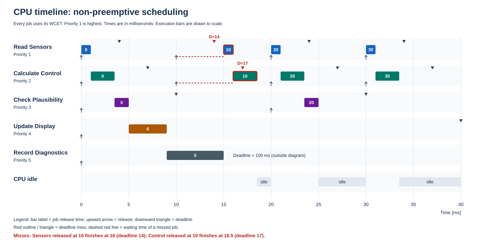
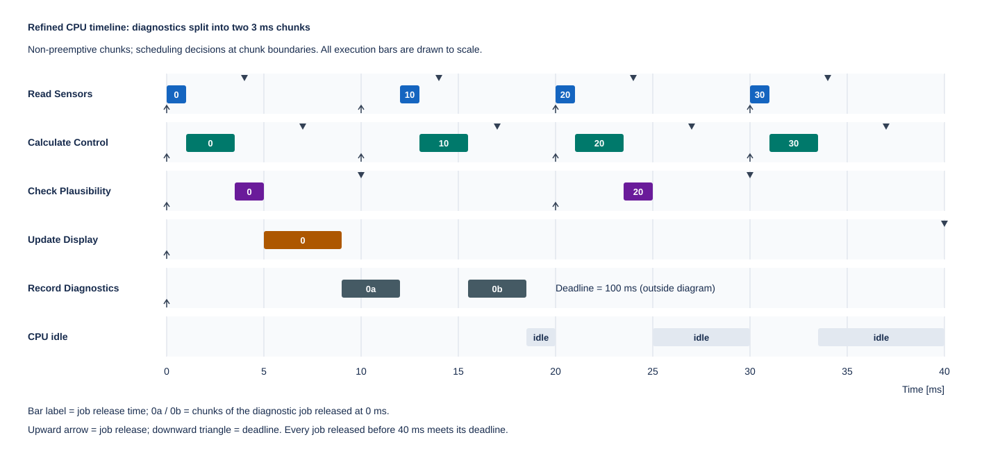

# Section V Solution: Timing Analysis of an Embedded Controller

This solution covers Tasks 1, 2, and 3.

## 1. Determine WCET and CPU Utilization

### Worst-Case Execution Times

Add the execution times of operations that run sequentially. For mutually exclusive alternatives, use the longer alternative.

| Task | Calculation | WCET `C` [ms] |
| --- | --- | --- |
| Read Sensors | `0.2 + 4 × 0.2` | 1 |
| Calculate Control | `0.5 + 5 × 0.4` | 2.5 |
| Check Plausibility | `0.3 + 3 × 0.4` | 1.5 |
| Update Display | `0.8 + 8 × 0.4` | 4 |
| Record Diagnostics | `1 + max(2, 5)` | 6 |

Record Diagnostics executes either normal processing or recovery processing, so their execution times are not added together. Its WCET includes recovery processing, even if recovery occurs infrequently.

These values describe CPU execution time. Any time spent waiting to start is additional and contributes to the job's response time.

### Frequencies and Utilization

With periods given in milliseconds:

```text
Frequency [Hz] = 1000 / T
Utilization [%] = (C / T) × 100
```

| Task | WCET `C` [ms] | Period `T` [ms] | Frequency [Hz] | Utilization [%] |
| --- | --- | --- | --- | --- |
| Read Sensors | 1 | 10 | 100 | 10 |
| Calculate Control | 2.5 | 10 | 100 | 25 |
| Check Plausibility | 1.5 | 20 | 50 | 7.5 |
| Update Display | 4 | 40 | 25 | 10 |
| Record Diagnostics | 6 | 100 | 10 | 6 |
| **Total** | — | — | — | **58.5** |

The remaining 41.5% represents unused capacity over the long term under the exercise's assumptions. It does not mean the CPU has that much spare time in every interval.

### Assessment of the Teammate's Claim

The claim is incorrect. Neither check accounts for when jobs can actually execute.

* **Total utilization below 100%:** The long-term workload does not exceed the CPU's capacity. This is a necessary capacity check, but it does not guarantee deadlines under the specified scheduler.
* **Each WCET shorter than its deadline:** Each job could meet its deadline if it started immediately and executed without waiting. This does not account for delays caused by other jobs.

What remains to be verified in Task 2 is whether every job finishes by its deadline when waiting times and scheduling priorities are taken into account.

## 2. Construct the Schedule and Verify Deadlines

All times below are in milliseconds. Each job executes for its WCET, and execution is non-preemptive.
The analysis covers jobs released in `0 <= t < 40`; releases at exactly 40 ms belong to the next interval.

### Releases and Deadlines

A job's absolute deadline is its release time plus its task's relative deadline.
Entries in each row correspond in order: for example, the sensor job released at 10 ms has its deadline at 14 ms.

| Task | Release times [ms] | Corresponding absolute deadlines [ms] |
| --- | --- | --- |
| Read Sensors | 0, 10, 20, 30 | 4, 14, 24, 34 |
| Calculate Control | 0, 10, 20, 30 | 7, 17, 27, 37 |
| Check Plausibility | 0, 20 | 10, 30 |
| Update Display | 0 | 40 |
| Record Diagnostics | 0 | 100 |

The diagnostic deadline lies outside the displayed interval, but its job is included because it is released at 0 ms.

### CPU Timeline



Execution bars are drawn to scale. Each bar is labeled with its job's release time. Upward arrows mark releases, and downward triangles mark deadlines. Red outlines and triangles identify deadline misses; dashed red lines show the affected jobs' waiting times.

At 10 ms, Read Sensors and Calculate Control become ready, but Record Diagnostics continues until 15 ms. Priority determines the next job to start; it does not interrupt an already running job in this model.

### Completion Times and Deadline Checks

```text
Response time = completion time − release time
Deadline met if completion time <= absolute deadline
Lateness of a missed deadline = completion time − absolute deadline
```

| Task / job release [ms] | Absolute deadline [ms] | Start [ms] | Completion [ms] | Response time [ms] | Deadline met? |
| --- | --- | --- | --- | --- | --- |
| Read Sensors / 0 | 4 | 0 | 1 | 1 | Yes |
| Calculate Control / 0 | 7 | 1 | 3.5 | 3.5 | Yes |
| Check Plausibility / 0 | 10 | 3.5 | 5 | 5 | Yes |
| Update Display / 0 | 40 | 5 | 9 | 9 | Yes |
| Record Diagnostics / 0 | 100 | 9 | 15 | 15 | Yes |
| Read Sensors / 10 | 14 | 15 | 16 | 6 | **No: 2 ms late** |
| Calculate Control / 10 | 17 | 16 | 18.5 | 8.5 | **No: 1.5 ms late** |
| Read Sensors / 20 | 24 | 20 | 21 | 1 | Yes |
| Calculate Control / 20 | 27 | 21 | 23.5 | 3.5 | Yes |
| Check Plausibility / 20 | 30 | 23.5 | 25 | 5 | Yes |
| Read Sensors / 30 | 34 | 30 | 31 | 1 | Yes |
| Calculate Control / 30 | 37 | 31 | 33.5 | 3.5 | Yes |

### Why the Deadlines Are Missed

The sensor job released at 10 ms waits 5 ms for diagnostics to finish, then executes for 1 ms. Its response time is `5 + 1 = 6 ms`, exceeding its 4 ms relative deadline. It finishes at 16 ms instead of by 14 ms.

The control job released at 10 ms waits for the same remaining 5 ms of diagnostics and then for the 1 ms sensor job. It executes for another 2.5 ms, giving a response time of `5 + 1 + 2.5 = 8.5 ms`. Its relative deadline is 7 ms, so it finishes at 18.5 ms instead of by 17 ms.

This is blocking by an already running lower-priority job. The controller has sufficient long-term CPU capacity, but the uninterrupted diagnostic execution delays urgent work too much.

The scheduler cannot leave the CPU idle at 9 ms to wait for the urgent releases at 10 ms: diagnostics is ready, and the exercise requires the CPU to run whenever a job is ready.

## 3. Refine the Architecture

### One Possible Change: Split Diagnostics into Two Chunks

Divide each diagnostic job into two sequential chunks with a WCET of 3 ms each. Each chunk remains non-preemptive, but the scheduler selects the highest-priority ready job again at the boundary between chunks.

The second chunk becomes ready immediately after the first finishes and retains priority 5. Both chunks share the diagnostic job's original deadline. All other tasks and priorities remain unchanged. As in the exercise, scheduling overhead is ignored.

Previously, diagnostics ran uninterrupted from 9 to 15 ms. With this change, its first chunk runs from 9 to 12 ms. The scheduler then runs the sensor and control jobs released at 10 ms before resuming diagnostics.

### Revised CPU Timeline



The numbers inside the boxes indicate each job's release time. Diagnostic boxes labeled `0a` and `0b` are the two chunks of the same job released at 0 ms. Arrows mark releases, and downward triangles mark deadlines.

The revised execution sequence is:

```text
0–1       Read Sensors (released at 0)
1–3.5     Calculate Control (released at 0)
3.5–5     Check Plausibility (released at 0)
5–9       Update Display (released at 0)
9–12      Record Diagnostics: first chunk (released at 0)
12–13     Read Sensors (released at 10)
13–15.5   Calculate Control (released at 10)
15.5–18.5 Record Diagnostics: second chunk (released at 0)
18.5–20   Idle
20–21     Read Sensors (released at 20)
21–23.5   Calculate Control (released at 20)
23.5–25   Check Plausibility (released at 20)
25–30     Idle
30–31     Read Sensors (released at 30)
31–33.5   Calculate Control (released at 30)
33.5–40   Idle
```

### Deadline Verification

| Task / job release [ms] | Absolute deadline [ms] | Completion [ms] | Response time [ms] | Deadline met? |
| --- | --- | --- | --- | --- |
| Read Sensors / 0 | 4 | 1 | 1 | Yes |
| Calculate Control / 0 | 7 | 3.5 | 3.5 | Yes |
| Check Plausibility / 0 | 10 | 5 | 5 | Yes |
| Update Display / 0 | 40 | 9 | 9 | Yes |
| Record Diagnostics / 0 | 100 | 18.5 | 18.5 | Yes |
| Read Sensors / 10 | 14 | 13 | 3 | Yes |
| Calculate Control / 10 | 17 | 15.5 | 5.5 | Yes |
| Read Sensors / 20 | 24 | 21 | 1 | Yes |
| Calculate Control / 20 | 27 | 23.5 | 3.5 | Yes |
| Check Plausibility / 20 | 30 | 25 | 5 | Yes |
| Read Sensors / 30 | 34 | 31 | 1 | Yes |
| Calculate Control / 30 | 37 | 33.5 | 3.5 | Yes |

The sensor job released at 10 ms now waits only 2 ms and finishes at 13 ms, before its deadline of 14 ms. The control job finishes at 15.5 ms, before its deadline of 17 ms. Diagnostics finishes later than before but still comfortably meets its own deadline.

Every job released in the requested interval meets its deadline with this change under the specified simultaneous-release, WCET assumptions.

### CPU Utilization and Tradeoff

CPU utilization remains **58.5%**. Diagnostics still consumes `3 + 3 = 6 ms` per 100 ms; splitting changes when work executes, not how much work is required.

The tradeoff is that diagnostic processing must support pausing at a safe intermediate point and preserving its state until the second chunk runs. A real implementation would also need to account for any added scheduling overhead.
